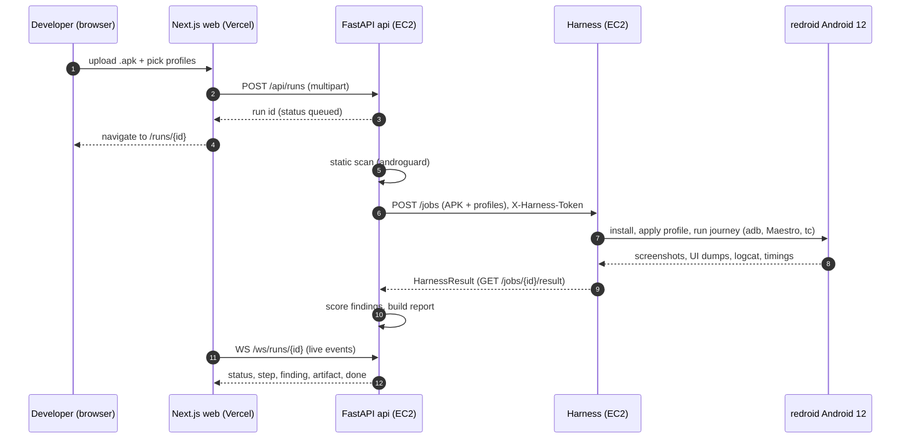
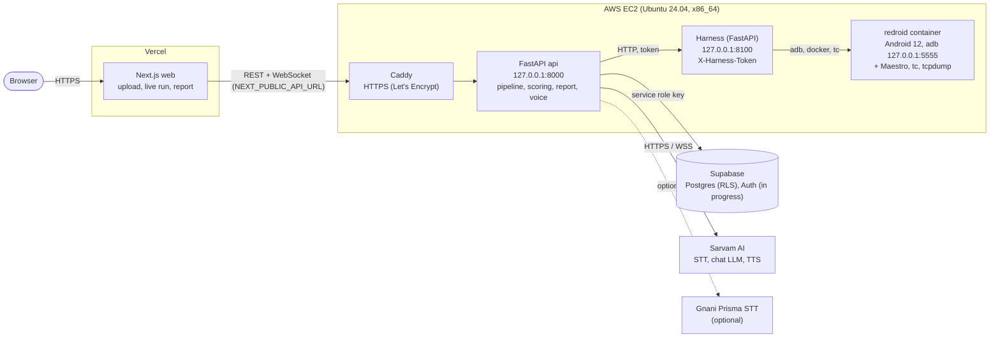

<div align="center">

# BharatBench

### The Real Phone Test: test your app where your users actually are.

**Upload an Android APK. BharatBench scans it, runs it on a constrained Android device under the conditions
Indian users really face, and ranks every problem by how many users it would hurt.**

[](https://python.org)
[](https://fastapi.tiangolo.com)
[](https://nextjs.org)
[](https://supabase.com)
[](https://docs.sarvam.ai)
[](https://github.com/remote-android/redroid-doc)

---

HackFront 2026 · Team **BrahMoss**

[Live demo](https://bharatbench-orpin.vercel.app) •
[What it checks](#what-it-checks) •
[Architecture](#architecture) •
[Fidelity](#fidelity-what-is-simulated-and-what-is-not) •
[Quick start](#quick-start) •
[Deployment](#deployment) •
[Status](#status)

</div>

---

## Overview

Most Android apps are tested on a flagship phone, on office Wi-Fi, with plenty of storage. Many of their
users have a 2 GB phone, a shaky mobile connection, nearly full storage, battery saver on, and an app that
gets killed the moment they switch apps.

BharatBench reproduces those conditions on a real Android 12 device, records what happened, and tells the
developer what to fix first:

- **Static scan** of the APK: security and size issues, found without running the app.
- **Runtime run** of the APK under one or more constrained profiles, with an automated UI journey, crash,
  ANR, network and state-loss detection, screenshots, UI dumps and logcat as evidence.
- **Impact ranking**: every finding gets a score from the share of target users it affects, its severity, and
  how often the flow is used. The assumptions are shown next to the score and can be adjusted.
- **Reproducible output**: a markdown report, and a Maestro flow for each runtime finding.
- **Voice** (in progress): start a test, hear progress and explanations in Hindi, English or Hinglish.

A run never invents results. If the device lab is unreachable, the run completes with static findings and
states why runtime testing was skipped.

---

## What it checks

| Area | Checks | Source |
| :--- | :--- | :--- |
| Security (static) | debuggable builds, `allowBackup`, cleartext traffic, exported components without permission, dangerous permissions, hard-coded secrets and keys, `http://` URLs, WebView JavaScript bridges | `api/app/analyzer/` |
| Size and performance (static) | APK size, dex count, bundled native ABIs, min/target SDK, missing shrinking or obfuscation | `api/app/analyzer/` |
| Launch and journey (runtime) | launch timing, automated crawl (launch plus N taps, with a label denylist for logout, delete, pay, buy, purchase, sign out, uninstall) | `harness/harness/crawler.py` |
| Stability (runtime) | crashes, ANRs, network error screens, stuck loading, state loss after process death, memory (PSS) | `harness/harness/`, `api/app/scoring.py` |
| Cleartext traffic (runtime) | short `tcpdump` capture during the run | `harness/harness/security.py` |
| Scoring | impact score = 100 × users exposed × severity weight × flow usage; overall reliability score | `api/app/scoring.py`, `api/app/report.py` |

---

## How a run flows



Every run ends as `done`, `failed` or `cancelled`. Any pipeline error is recorded on the run.

---

## Architecture



### Design rules

- **The APK never runs on the API host.** The API only parses it; the device lab runs it, inside redroid.
- **The harness is not public.** It listens on `127.0.0.1` and checks `X-Harness-Token` in constant time.
  Only the API calls it.
- **One device, one job at a time.** The harness returns 409 while a job is running.
- **Runtime is skipped, not faked.** `summary.runtime_executed` and `summary.runtime_skipped_reason` say so.
- **Every profile change is reverted**, even when the run fails (`try/finally`).
- **Only the storage layer touches the database.** `api/app/storage/` implements SQLite and Supabase behind one
  interface.

### Tech stack

| Layer | Technology |
| :--- | :--- |
| Web | Next.js 16 (App Router), React 19, TypeScript, Tailwind CSS v4, shadcn/ui |
| API | Python 3.12+, FastAPI, uvicorn, Pydantic v2, httpx, androguard (static APK parsing), uv |
| Harness | Python 3.12+, FastAPI, adb, Maestro CLI, tc/netem, tcpdump, docker (redroid) |
| Device | redroid (Android 12 in a container), 127.0.0.1:5555 |
| Voice and AI | Sarvam streaming STT, chat LLM with tool calling, TTS (`bulbul:v3`); optional Gnani Prisma STT |
| Data | SQLite (default) or Supabase Postgres via PostgREST; files under `DATA_DIR` |
| Hosting | Vercel (web), AWS EC2 with Caddy and systemd (API and harness) |
| CI/CD | GitHub Actions: ruff, pytest (api, harness), web lint, `tsc`, `next build`; push to `main` deploys the API over SSH |

---

## Fidelity: what is simulated, and what is not

Each profile in `api/app/profiles.py` carries a fidelity label. The label is shown on every profile in the UI
and in the report. A profile marked `unsupported` is never offered as runnable.

| Profile | Fidelity | What is applied | What is NOT simulated |
| :--- | :--- | :--- | :--- |
| **Baseline** | controlled | Android 12 redroid container with a 2 GB memory cap, normal network | Nothing else. This is the reference run |
| **Budget phone, 2 Mbps** (`budget_2gb`) | approximated | Container memory capped at 2 GB (cgroup OOM kills); `tc netem` on the container link: 2 Mbit/s download, 200 ms delay with 100 ms jitter, upload policed to 2 Mbit/s | Host CPU is not throttled, so slow-CPU behaviour is not simulated |
| **Intermittent network** (`flaky_network`) | controlled | `tc netem loss 100%` for 6 s, restored for 4 s, repeated through the journey | Wi-Fi and mobile-data toggles do not cut connectivity on redroid |
| **Low storage, about 400 MB free** (`low_storage`) | controlled (design) | Filler file in `/data/local/tmp` until about 400 MB is free, removed afterwards | **Not applied on redroid**: its `/data` is the shared host disk, so the run reports the condition as not applied |
| **Battery saver** (`battery_saver`) | approximated | `dumpsys battery` unplug and level 10%, `low_power` set; reset afterwards | The redroid effect of battery saver is unverified; OEM-specific task killers are not simulated |
| **Process death and restore** (`process_death`) | controlled | Home, `am kill <package>`, relaunch; UI compared before and after | Nothing else |

Not simulated, and reported as such: **thermal throttling**, **slow CPU** and **OEM background killers**
(Xiaomi, Oppo, Vivo). They need physical hardware.

The `users_exposed` values in the profiles are **assumptions**, not measured data. They are shown in the UI and
the report, and they can be changed.

---

## Quick start

You need Python 3.12+, [uv](https://docs.astral.sh/uv/), Node.js 24 (as in CI) and npm. Runtime testing also
needs a Linux host with Docker and a redroid container; without it, the API still runs and reports runtime as
skipped.

### 1. API (`api/`)

```bash
cd api
uv sync
cp .env.example .env            # fill in what you have; every key is optional for static-only runs
uv run uvicorn app.main:app --reload --port 8000
curl http://localhost:8000/api/health
```

### 2. Web (`web/`)

```bash
cd web
npm install
cp .env.example .env.local      # NEXT_PUBLIC_API_URL=http://localhost:8000
npm run dev                     # http://localhost:3000
```

### 3. Harness (`harness/`, Linux only, optional)

Runtime testing needs a Linux host with Docker, adb, Maestro and a running redroid container exposing adb on
`127.0.0.1:5555`. See [docs/SETUP.md](docs/SETUP.md) for the host steps.

```bash
cd harness
uv sync
cp .env.example .env            # set HARNESS_TOKEN (openssl rand -hex 32)
uv run uvicorn harness.main:app --host 127.0.0.1 --port 8100
```

Then set `HARNESS_URL=http://127.0.0.1:8100` and the same `HARNESS_TOKEN` in `api/.env`. On a laptop, reach a
remote harness with an SSH tunnel:

```bash
ssh -i <path-to-key>.pem -N -L 8100:127.0.0.1:8100 ubuntu@<EC2_HOST>
```

### Tests and checks

```bash
cd api && uv run ruff check . && uv run pytest -q
cd harness && uv run ruff check . && uv run pytest -q
cd web && npm run lint && npx next typegen && npx tsc --noEmit && npm run build
```

---

## Environment variables

Each app has its own file. Copy the `.env.example` next to it and fill in the values. Never commit real values.

### API (`api/.env`, see [`api/.env.example`](api/.env.example))

| Variable | Default | Purpose |
| :--- | :--- | :--- |
| `DATA_DIR` | `../data` | SQLite database, APKs and artifacts |
| `CORS_ORIGINS` | `http://localhost:3000` | Comma-separated origins allowed to call the API |
| `STORAGE_BACKEND` | `sqlite` | `sqlite` or `supabase` |
| `HARNESS_URL` | empty | Harness base URL. Empty means runtime is skipped |
| `HARNESS_TOKEN` | empty | Must match the harness `HARNESS_TOKEN` |
| `SARVAM_API_KEY` | empty | Sarvam key for the voice agent and explanations (server-side) |
| `LLM_BASE_URL`, `LLM_MODEL`, `LLM_API_KEY` | `https://api.sarvam.ai/v1`, `sarvam-105b`, empty | Chat LLM endpoint, model, key (key falls back to `SARVAM_API_KEY`) |
| `SARVAM_STREAM_STT`, `SARVAM_STREAM_TTS` | `true` | Streaming speech-to-text and text-to-speech; `false` uses REST |
| `SARVAM_CHAT_MODEL`, `SARVAM_TTS_MODEL`, `SARVAM_TTS_SPEAKER` | `sarvam-105b-conversations`, `bulbul:v3`, `shubh` | Voice agent models and speaker |
| `ENDPOINT_GRACE_MS`, `CONTEST_TIMEOUT_S` | `180`, `3.0` | Voice turn timing |
| `GNANI_API_KEY`, `GNANI_STT_WS_URL`, `GNANI_STT_MODEL`, `GNANI_STT_FORMAT` | empty, default endpoint, `prisma-v3.0`, `codemix` | Optional Gnani Prisma speech-to-text. Inert without the key |
| `SUPABASE_URL`, `SUPABASE_SERVICE_ROLE_KEY` | empty | Supabase storage (server-side only) |
| `SUPABASE_JWT_SECRET`, `AUTH_REQUIRED` | empty, `false` | Planned auth: JWT verification and enforcement |
| `API_BASE` | empty | Optional base URL the voice agent prepends to API links |
| `BB_SAMPLE_APK` | empty | Test only: APK for the optional analyzer smoke test |

### Harness (`harness/.env`, see [`harness/.env.example`](harness/.env.example))

| Variable | Default | Purpose |
| :--- | :--- | :--- |
| `HARNESS_TOKEN` | required | Shared secret, sent as `X-Harness-Token` |
| `DEVICE_KIND` | `redroid` | `redroid` or `emulator` |
| `ANDROID_SERIAL` | `127.0.0.1:5555` | adb serial of the device |
| `CONTAINER_NAME` | `redroid` | Docker container used by health checks and self-repair |
| `DOCKER_PATH`, `ADB_PATH`, `MAESTRO_PATH` | `docker`, `adb`, `maestro` | Tool locations |
| `TC_PATH`, `IP_PATH`, `SUDO_PATH`, `TCPDUMP_PATH`, `TIMEOUT_PATH` | `/usr/sbin/tc`, `/usr/sbin/ip`, `sudo`, `/usr/bin/tcpdump`, `/usr/bin/timeout` | Host tools for shaping and the security capture |
| `JOBS_DIR`, `KEEP_JOBS` | `./jobs`, `5` | Job working directories and retention |
| `MAX_APK_MB` | `300` | Harness-side APK size limit |
| `JOB_TIMEOUT_S`, `PROFILE_TIMEOUT_S`, `BOOT_TIMEOUT_S`, `RECONNECT_WAIT_S` | `720`, `300`, `120`, `20` | Timeouts in seconds |
| `SECURITY_ENABLED`, `SECURITY_TIMEOUT_S` | `true`, `150` | Cleartext-traffic capture |
| `MIN_FREE_MB`, `HARD_MIN_FREE_MB` | `600`, `300` | Disk health gate |

### Web (`web/.env.local`, see [`web/.env.example`](web/.env.example))

| Variable | Purpose |
| :--- | :--- |
| `NEXT_PUBLIC_API_URL` | Base URL of the API. Embedded in the browser bundle |
| `NEXT_PUBLIC_SUPABASE_URL`, `NEXT_PUBLIC_SUPABASE_ANON_KEY` | Supabase project URL and anon key. The anon key is public by design; the service-role key never goes in the web app |

---

## Deployment

| Part | Where | How |
| :--- | :--- | :--- |
| Web | Vercel | Project root directory `web`, auto-deploys from `main` through the GitHub integration. Set the three `NEXT_PUBLIC_*` variables in Vercel |
| API | AWS EC2 (Ubuntu 24.04) | systemd unit `deploy/bharatbench-api.service` behind Caddy (`deploy/Caddyfile`, automatic HTTPS) |
| Harness | Same EC2 host | systemd unit `deploy/bharatbench-harness.service` on `127.0.0.1:8100`, with redroid on `127.0.0.1:5555` |
| Database | Supabase | Apply `supabase/migrations/*.sql` in order |

Setup scripts: `deploy/setup_api_ec2.sh` (Caddy, uv, API service) and `deploy/setup_harness_ec2.sh` (sudoers
drop-ins for `tc` and `tcpdump`, kernel modules, harness service). The step-by-step guide is in
[docs/SETUP.md](docs/SETUP.md).

### CI/CD

[`.github/workflows/ci-cd.yml`](.github/workflows/ci-cd.yml) runs on every push and pull request: API tests and
ruff, harness tests and ruff, web lint, typegen, `tsc` and `next build`. On a push to `main` that passes, the
`deploy-api` job connects over SSH and runs `deploy/deploy_api.sh` (pull, sync, restart, health check), then
checks the public `/api/health` endpoint. It uses the `EC2_HOST` and `EC2_SSH_KEY` secrets in the `production`
environment.

---

## Project structure

```text
bharatbench/
├── api/                    FastAPI: runs, pipeline, static analyzer, scoring, report, voice agent
│   ├── app/models.py       frozen contracts (source of truth for names)
│   ├── app/profiles.py     frozen condition profiles and fidelity labels
│   ├── app/analyzer/       static APK analysis (androguard)
│   ├── app/voice/          Sarvam voice agent and tools
│   ├── app/realtime/       streaming voice pipeline
│   ├── app/storage/        SQLite and Supabase behind one interface
│   └── app/routes/         HTTP and WebSocket routes
├── harness/                FastAPI on the EC2 device host: redroid, adb, Maestro, tc, evidence
├── web/                    Next.js app: upload, live run, report, voice panel
├── contracts/README.md     frozen REST, WebSocket, harness and voice contracts
├── context/                project overview, architecture, UI and code standards, progress tracker
├── features/               one spec per feature (features/README.md is the index)
├── deploy/                 Caddyfile, systemd units, EC2 setup and deploy scripts
├── supabase/migrations/    database schema
├── docs/SETUP.md           step-by-step host and Vercel setup
└── .github/workflows/      CI/CD
```

---

## Security and privacy

- **Secrets stay on the server.** Sarvam, Supabase service-role and harness tokens are read only by the API and
  harness. `.env*`, `secrets/` and `data/` are git-ignored.
- **Uploaded APKs are not executed on the API host.** They are parsed there and run only inside the device lab.
- **The harness is private.** It listens on `127.0.0.1`, requires `X-Harness-Token`, takes one job at a time,
  and validates paths and job ids before any file or adb operation.
- **Artifact paths are confined.** Paths with `..` or absolute paths are rejected.
- **Database access.** Supabase tables have RLS enabled with no public policies. Only the API's server-side
  service-role key reads and writes them.
- **The voice agent has no shell access.** It can only call the tools listed in `contracts/README.md` section 6.
  Cancelling a run requires an explicit user request.
- **No authentication yet in the prototype.** Auth is planned (Supabase Auth, JWT verification and RLS per user).
  Until then the API is meant to run behind the demo host, not as a public multi-user service.

---

## Status

Current state is tracked in [`context/progress-tracker.md`](context/progress-tracker.md) and
[`features/README.md`](features/README.md). In short:

| Area | Status |
| :--- | :--- |
| Static APK analysis, scoring, report | Implemented (`api/`) |
| Runtime testing on the device lab (profiles, journey, evidence) | Implemented in `harness/`; live end-to-end on the EC2 device host is the current milestone |
| Web UI: upload, live run, report | Implemented (`web/`) |
| Voice agent (Sarvam STT, LLM, TTS) | In progress (realtime voice and conversations) |
| Supabase storage backend | Implemented, selected with `STORAGE_BACKEND=supabase` (SQLite is the default) |
| Supabase Auth and per-user data | Planned (in progress) |
| GitHub repository to APK build | Deferred: untrusted build scripts and toolchain variance |
| Resend emails on run completion | Deferred: needs user emails from auth |
| Multi-device concurrency and job queue | Deferred: one device, one job |
| Thermal, slow-CPU and OEM-killer conditions | Not simulated: need physical devices |

---

## Team

**BrahMoss**, HackFront 2026.

## License

No license file has been added yet. All rights reserved by the team until one is chosen.
