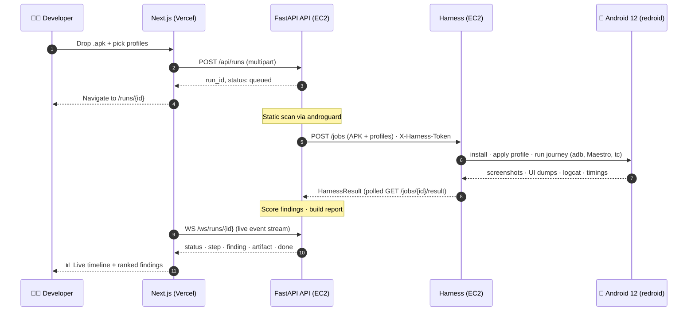
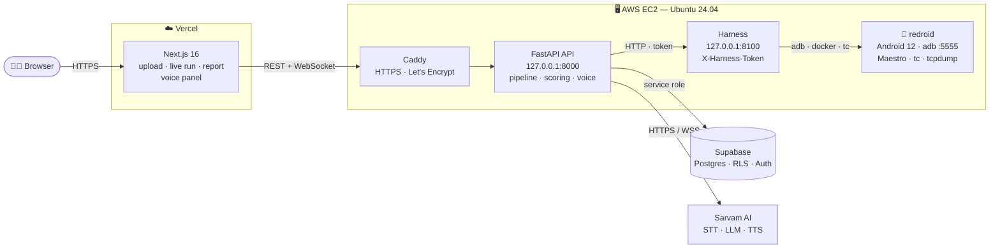

<div align="center">

<br/>

<pre align="center">
██████╗ ██╗  ██╗ █████╗ ██████╗  █████╗ ████████╗
██╔══██╗██║  ██║██╔══██╗██╔══██╗██╔══██╗╚══██╔══╝
██████╔╝███████║███████║██████╔╝███████║   ██║
██╔══██╗██╔══██║██╔══██║██╔══██╗██╔══██║   ██║
██████╔╝██║  ██║██║  ██║██║  ██║██║  ██║   ██║
╚═════╝ ╚═╝  ╚═╝╚═╝  ╚═╝╚═╝  ╚═╝╚═╝  ╚═╝   ╚═╝

██████╗ ███████╗███╗   ██╗ ██████╗██╗  ██╗
██╔══██╗██╔════╝████╗  ██║██╔════╝██║  ██║
██████╔╝█████╗  ██╔██╗ ██║██║     ███████║
██╔══██╗██╔══╝  ██║╚██╗██║██║     ██╔══██║
██████╔╝███████╗██║ ╚████║╚██████╗██║  ██║
╚═════╝ ╚══════╝╚═╝  ╚═══╝ ╚═════╝╚═╝  ╚═╝
</pre>

### *The Real Phone Test*

**Upload an APK. Watch it run on an actual Android 12 device — under the conditions 600 million Indian users live with every day. Get every problem ranked by exactly how many of them it hurts.**

<br/>

[](https://python.org)
[](https://fastapi.tiangolo.com)
[](https://nextjs.org)
[](https://react.dev)
[](https://typescriptlang.org)

[](https://supabase.com)
[](https://github.com/remote-android/redroid-doc)
[](https://docs.sarvam.ai)
[](.github/workflows/ci-cd.yml)

<br/>

[**🚀 Live Demo**](https://bharatbench-orpin.vercel.app) &nbsp;·&nbsp;
[**What it checks**](#-what-it-checks) &nbsp;·&nbsp;
[**How it works**](#-how-it-works) &nbsp;·&nbsp;
[**Architecture**](#-architecture) &nbsp;·&nbsp;
[**Quick start**](#-quick-start) &nbsp;·&nbsp;
[**Voice agent**](#-voice-agent) &nbsp;·&nbsp;
[**Deployment**](#-deployment)

<br/>

> HackFront 2026 · Team **BrahMoss**

</div>

---

## The Problem

Most Android apps are tested on a flagship phone, on office Wi-Fi, with 128 GB of free storage.

Your users don't have that phone.

> *India has 600M+ smartphone users. The majority use an everyday 2–4 GB Android device, on a mobile connection that drops, with storage almost full, battery saver permanently on, and their phone killing your app the moment they switch to WhatsApp.*

BharatBench reproduces those conditions on a **real Android 12 device**, records exactly what breaks, and tells you what to fix first — ranked by the number of users it hurts.

---

## ✅ What it checks

<table>
<tr>
<td width="50%">

### 🔒 Security (static)
- Debuggable release builds
- `allowBackup` exposing user data
- Cleartext HTTP traffic
- Exported components without permissions
- Dangerous permissions
- Hard-coded secrets and API keys
- `http://` URLs in code
- WebView JavaScript bridges

</td>
<td width="50%">

### ⚡ Performance (static)
- APK size and dex count
- Bundled native ABIs (unnecessary weight)
- Min/target SDK levels
- Missing code shrinking or obfuscation
- Multi-dex configurations

</td>
</tr>
<tr>
<td>

### 📱 Runtime — Stability
- App launch timing under each profile
- Crashes and ANRs (with full logcat)
- Network error screens
- Stuck loading states
- Memory pressure (PSS measurement)
- State loss after process death

</td>
<td>

### 🌐 Runtime — Network & Security
- Cleartext traffic capture via `tcpdump`
- Behaviour on 2 Mbps with 200 ms delay
- Behaviour during 6 s total network blackout
- Automated UI journey (launch + N taps, with a safe denylist for destructive actions)

</td>
</tr>
</table>

Every finding gets an **impact score** — `100 × users_exposed × severity_weight × flow_usage` — with the assumptions shown next to it, so you can adjust them.

---

## ⚙️ How it works



**Iron-clad guarantees:**
- 🚫 **The APK never runs on the API host.** Only parsed there. Executed only inside redroid.
- 🚫 **Runtime is never faked.** If the device lab is unreachable, the run finishes with static findings and a clear `runtime_skipped_reason`.
- 🚫 **Findings are never invented.** Every runtime finding cites at least one evidence item from an actual device run.
- ✅ **Every profile change is reverted**, even when the run fails (`try/finally` in harness).

---

## 🏗️ Architecture



### Design rules

| Rule | Why |
|:---|:---|
| APK executes only inside redroid | Untrusted code never runs on the API host |
| Harness listens on `127.0.0.1` + `X-Harness-Token` | Not reachable from the internet |
| One device, one job (409 on conflict) | Prevents race conditions on the shared device |
| `runtime_executed` / `runtime_skipped_reason` on every run | Honesty invariant — no ambiguity |
| Only `api/app/storage/` touches the database | Clean separation; swap SQLite ↔ Supabase without touching pipeline logic |

### Tech stack

| Layer | Technology |
|:---|:---|
| **Web** | Next.js 16.4, React 19, TypeScript 5, Tailwind CSS v4, shadcn/ui, Base UI |
| **API** | Python 3.12+, FastAPI, uvicorn, Pydantic v2, httpx, androguard, uv |
| **Harness** | Python 3.12+, FastAPI, adb, Maestro CLI, tc/netem, tcpdump, Docker (redroid) |
| **Device** | redroid — Android 12 in a container, `127.0.0.1:5555` |
| **Voice & AI** | Sarvam streaming STT + chat LLM (`sarvam-105b`) + TTS (`bulbul:v3`); optional Gnani Prisma STT |
| **Data** | SQLite (default) or Supabase Postgres via PostgREST; artifacts under `DATA_DIR` |
| **Auth** | Supabase guest + Google sign-in (`AUTH_REQUIRED` flag, off by default) |
| **Hosting** | Vercel (web) · AWS EC2 + Caddy + systemd (API and harness) |
| **CI/CD** | GitHub Actions — ruff, pytest (api + harness), ESLint, tsc, next build; push to `main` auto-deploys |

---

## 🇮🇳 Condition profiles and fidelity

Each profile carries a fidelity label shown in the UI and report. A profile marked `unsupported` is never offered as runnable.

| Profile | Fidelity | What is applied | What is **not** simulated |
|:---|:---|:---|:---|
| **Baseline** | `controlled` | Android 12 redroid · 2 GB memory cap · normal network | Reference only |
| **Budget phone, 2 Mbps** | `approximated` | 2 GB cgroup cap · `tc netem` 2 Mbit/s · 200 ms + 100 ms jitter | Host CPU not throttled — slow-CPU behaviour absent |
| **Intermittent network** | `controlled` | `tc netem loss 100%` for 6 s, restored 4 s, repeated | Wi-Fi / mobile-data toggles do not cut redroid connectivity |
| **Low storage (~400 MB free)** | `controlled` *(design)* | Filler file in `/data/local/tmp` to fill to ~400 MB | **Not applied on redroid** — `/data` is the host disk |
| **Battery saver** | `approximated` | `dumpsys battery` unplug · level 10% · `low_power` on; reset after | redroid battery-saver effect is unverified; OEM killers not simulated |
| **Process death & restore** | `controlled` | Home → `am kill <pkg>` → relaunch · UI compared before and after | Nothing else |

> **Not simulated (need physical hardware):** thermal throttling, slow CPU, Xiaomi / Oppo / Vivo OEM background killers.
>
> `users_exposed` values are **stated assumptions**, not measured data — they are shown in the UI and report and can be adjusted.

---

## 🎙️ Voice agent

Speak to BharatBench in **Hindi, English or Hinglish**. The voice agent uses Sarvam streaming STT → LLM tool calling → TTS, with barge-in that stops speech within ~300 ms.

```
"mera app slow network pe test karo"
→  Agent calls start_test, narrates progress in Hindi

"sabse bada issue kya hai?"
→  Agent calls list_findings + explain_finding, speaks the top finding

"iska fix kya hai?"
→  Agent explains the cause and suggested fix
```

**13 tools available to the voice agent** (defined in `api/app/voice/tools.py` and frozen in `contracts/README.md`):
start test · get run status · list findings · explain finding · list runs · get report · compare runs · get Play risk · get team brief · list profiles · get profile · list conversations · get insights

The agent has **no shell access** and cannot call the harness directly. Stopping a run is HTTP-only and graceful.

---

## 🚀 Quick start

**Prerequisites:** Python 3.12+, [uv](https://docs.astral.sh/uv/), Node.js 20+, npm.
Runtime testing also needs a Linux host with Docker and a running redroid container — without it, the API still works and reports runtime as skipped.

### 1. API

```bash
cd api
uv sync
cp .env.example .env        # every key is optional for static-only runs
uv run uvicorn app.main:app --reload --port 8000
curl http://localhost:8000/api/health
```

### 2. Web

```bash
cd web
npm install
cp .env.example .env.local  # set NEXT_PUBLIC_API_URL=http://localhost:8000
npm run dev                 # → http://localhost:3000
```

### 3. Harness *(Linux only, optional)*

Runtime testing requires a Linux host with Docker, adb, Maestro CLI and a redroid container on `127.0.0.1:5555`.
See [docs/SETUP.md](docs/SETUP.md) for the full host setup.

```bash
cd harness
uv sync
cp .env.example .env        # set HARNESS_TOKEN (openssl rand -hex 32)
uv run uvicorn harness.main:app --host 127.0.0.1 --port 8100
```

Then in `api/.env` set `HARNESS_URL=http://127.0.0.1:8100` with the same `HARNESS_TOKEN`.
On a laptop, tunnel to a remote harness via SSH:

```bash
ssh -i <key>.pem -N -L 8100:127.0.0.1:8100 ubuntu@<EC2_HOST>
```

### Tests and checks

```bash
# API
cd api && uv run ruff check . && uv run pytest -q

# Harness
cd harness && uv run ruff check . && uv run pytest -q

# Web
cd web && npm run lint && npx next typegen && npx tsc --noEmit && npm run build
```

No device, API keys, or network are needed for the Python suites — harness tests mock adb; API tests mock the harness and LLM.

---

## 🔑 Environment variables

### API — `api/.env` (see [`api/.env.example`](api/.env.example))

| Variable | Default | Purpose |
|:---|:---|:---|
| `DATA_DIR` | `../data` | SQLite database, APKs, artifacts |
| `CORS_ORIGINS` | `http://localhost:3000` | Comma-separated allowed origins |
| `STORAGE_BACKEND` | `sqlite` | `sqlite` or `supabase` |
| `HARNESS_URL` | *(empty)* | Harness base URL — empty = runtime skipped |
| `HARNESS_TOKEN` | *(empty)* | Must match the harness token |
| `SARVAM_API_KEY` | *(empty)* | Sarvam key for voice and AI explanations |
| `LLM_BASE_URL`, `LLM_MODEL`, `LLM_API_KEY` | `https://api.sarvam.ai/v1`, `sarvam-105b`, *(empty)* | Chat LLM endpoint, model, key |
| `SARVAM_STREAM_STT`, `SARVAM_STREAM_TTS` | `true` | Streaming STT/TTS; `false` uses REST |
| `SARVAM_CHAT_MODEL`, `SARVAM_TTS_MODEL`, `SARVAM_TTS_SPEAKER` | `sarvam-105b-conversations`, `bulbul:v3`, `shubh` | Voice agent config |
| `GNANI_API_KEY` | *(empty)* | Optional Gnani Prisma STT — inert without key |
| `SUPABASE_URL`, `SUPABASE_SERVICE_ROLE_KEY` | *(empty)* | Supabase storage (server-side only) |
| `SUPABASE_JWT_SECRET`, `AUTH_REQUIRED` | *(empty)*, `false` | JWT verification and enforcement |
| `BB_SAMPLE_APK` | *(empty)* | Test-only: APK for the analyzer smoke test |

### Harness — `harness/.env` (see [`harness/.env.example`](harness/.env.example))

| Variable | Default | Purpose |
|:---|:---|:---|
| `HARNESS_TOKEN` | **required** | Shared secret, sent as `X-Harness-Token` |
| `DEVICE_KIND` | `redroid` | `redroid` or `emulator` |
| `ANDROID_SERIAL` | `127.0.0.1:5555` | adb serial of the device |
| `CONTAINER_NAME` | `redroid` | Docker container name for health checks |
| `JOBS_DIR`, `KEEP_JOBS` | `./jobs`, `5` | Job working directories and retention |
| `MAX_APK_MB` | `300` | Harness-side APK size limit |
| `JOB_TIMEOUT_S` | `720` | Maximum seconds per job |
| `SECURITY_ENABLED` | `true` | Enable cleartext traffic capture |

### Web — `web/.env.local` (see [`web/.env.example`](web/.env.example))

| Variable | Purpose |
|:---|:---|
| `NEXT_PUBLIC_API_URL` | Base URL of the API — embedded in the browser bundle |
| `NEXT_PUBLIC_SUPABASE_URL` | Supabase project URL |
| `NEXT_PUBLIC_SUPABASE_ANON_KEY` | Supabase anon key (public by design; service-role key never goes in the web app) |

---

## 🚢 Deployment

| Part | Where | How |
|:---|:---|:---|
| **Web** | Vercel | Root directory `web`, auto-deploys from `main`. Set the three `NEXT_PUBLIC_*` vars in Vercel. |
| **API** | AWS EC2 (Ubuntu 24.04) | systemd unit `deploy/bharatbench-api.service` behind Caddy (`deploy/Caddyfile`, automatic HTTPS) |
| **Harness** | Same EC2 host | systemd unit `deploy/bharatbench-harness.service` on `127.0.0.1:8100`, redroid on `127.0.0.1:5555` |
| **Database** | Supabase | Apply `supabase/migrations/*.sql` in order |

Setup scripts: [`deploy/setup_api_ec2.sh`](deploy/setup_api_ec2.sh) and [`deploy/setup_harness_ec2.sh`](deploy/setup_harness_ec2.sh).
Step-by-step guide: [docs/SETUP.md](docs/SETUP.md).

### CI/CD

[`.github/workflows/ci-cd.yml`](.github/workflows/ci-cd.yml) runs on every push and PR:
API tests + ruff · harness tests + ruff · web lint + typegen + tsc + next build.

On a push to `main` that passes, the `deploy-api` job SSHs in and runs [`deploy/deploy_api.sh`](deploy/deploy_api.sh) (pull → sync → restart → health check). Uses `EC2_HOST` and `EC2_SSH_KEY` secrets in the `production` environment.

---

## 🔐 Security and privacy

- **Secrets stay on the server.** Sarvam, Supabase service-role and harness tokens are read only by the API and harness. `.env*`, `secrets/` and `data/` are git-ignored.
- **Uploaded APKs are not executed on the API host.** Parsed there; run only inside the device lab.
- **The harness is private.** `127.0.0.1` only, `X-Harness-Token` checked in constant time, one job at a time, paths validated before any file or adb operation.
- **Artifact paths are confined.** Paths with `..` or absolute paths are rejected.
- **RLS is enabled on all Supabase tables.** `conversations`, `messages` and `profiles` have own-row policies; `runs`, `findings` and `events` are written only via the server-side service-role key.
- **The voice agent has no shell access.** It calls only the 13 tools in `contracts/README.md §6`. There is no cancel-run tool; stopping a run is HTTP-only and graceful.
- **Auth.** Supabase guest and Google sign-in are implemented but `AUTH_REQUIRED` defaults to `false`. A default deployment is not a locked-down multi-user service.

---

## 📂 Project structure

```
bharatbench/
├── api/                        FastAPI: pipeline, analyzer, scoring, report, voice
│   └── app/
│       ├── models.py           ★ frozen data contracts (source of truth)
│       ├── profiles.py         ★ frozen condition profiles + fidelity labels
│       ├── pipeline.py         run orchestration (static → harness → score)
│       ├── services.py         run lifecycle management
│       ├── scoring.py          impact score calculation
│       ├── report.py           markdown report generation
│       ├── planner.py          deterministic test planner
│       ├── agent_tests.py      LLM-written app tests
│       ├── insights.py         Play risk · compare · team brief
│       ├── live.py             live phone view relay
│       ├── github_import.py    GitHub repo import
│       ├── harness_client.py   typed harness HTTP client
│       ├── analyzer/           static APK rules (security, perf, dedupe, explain)
│       ├── voice/              REST voice agent + 13 tools
│       ├── realtime/           streaming voice (WS /ws/realtime)
│       ├── auth/               Supabase JWT verification
│       ├── conversations/      conversation store
│       ├── storage/            SQLite and Supabase behind one interface
│       └── routes/             HTTP and WebSocket routes
├── harness/                    EC2 device-host service
│   └── harness/
│       ├── jobs.py             ★ job runner (profile apply, journey, revert)
│       ├── crawler.py          automated UI journey
│       ├── profiles.py         profile application and revert (tc, adb, docker)
│       ├── security.py         dynamic security checks + tcpdump capture
│       ├── heal.py             watchdog and self-repair
│       ├── agent.py            agent-written test execution
│       ├── forms.py            form detection and filling
│       ├── live.py             live screenshot streaming
│       ├── adb.py              adb helpers
│       └── evidence.py         evidence collection
├── web/                        Next.js 16 frontend
│   ├── app/                    App Router pages (auth, chat, login, new, runs)
│   ├── components/             UI components
│   └── lib/                    API client, types, voice, Supabase
├── contracts/                  ★ frozen REST, WebSocket, harness + voice contracts
├── context/                    architecture, standards, progress tracker
├── features/                   f02–f23 feature specs
├── docs/                       EVALUATION · FEATURE_MAP · SETUP · PROMPTS · CONFIG
├── supabase/migrations/        Postgres schema + RLS policies
├── deploy/                     Caddyfile · systemd units · EC2 scripts
└── .github/workflows/          CI/CD
```

---

## 📊 Status

| Area | Status |
|:---|:---|
| Static APK analysis · scoring · report | ✅ Implemented |
| Runtime testing on the device lab | ✅ Implemented (`harness/`) |
| Web UI — upload · live run · report | ✅ Implemented (`web/`) |
| Voice agent — Sarvam STT · LLM · TTS | ✅ Implemented (realtime + REST) |
| Realtime streaming voice (WebSocket) | ✅ Implemented |
| Supabase storage backend | ✅ Implemented (`STORAGE_BACKEND=supabase`) |
| Supabase Auth · per-user data | ✅ Implemented (`AUTH_REQUIRED` off by default) |
| Reliability — watchdog · recovery · self-heal | ✅ Implemented (`f18`) |
| Multilingual voice — Hindi · English · Hinglish | ✅ Implemented (`f17`) |
| Play risk · compare · team brief insights | ✅ Implemented (`f20`) |
| Agent-written tests | ✅ Implemented (`f23`) |
| GitHub repository → APK build | ⏸️ Deferred — untrusted build scripts |
| Resend emails on run completion | ⏸️ Deferred — needs user emails from auth |
| Multi-device concurrency and job queue | ⏸️ Deferred — one device, one job for now |
| Thermal · slow-CPU · OEM-killer conditions | ❌ Not simulated — need physical hardware |

Full feature map: [`docs/FEATURE_MAP.md`](docs/FEATURE_MAP.md). Progress: [`context/progress-tracker.md`](context/progress-tracker.md).

---

## 👥 Team

**BrahMoss** — HackFront 2026

---

## 📄 License

No license file has been added yet. All rights reserved by the team until one is chosen.

---

<div align="center">

*Built in India · Tested under Indian conditions · For the phones your users really carry*

</div>
